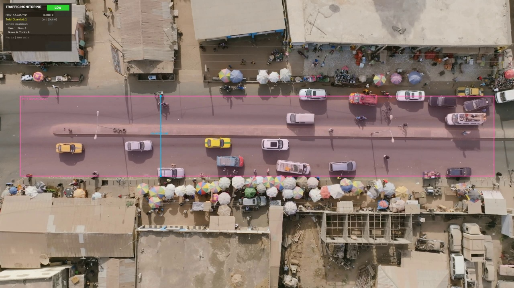
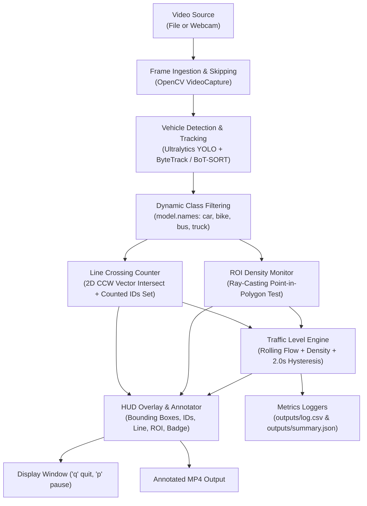

<div align="center">

#  Real-Time Traffic Monitoring System with YOLO

*A software-only computer vision pipeline for real-time vehicle detection, multi-object tracking, line-crossing counting, and dynamic traffic level classification.*

[](https://www.python.org/)
[](https://pytorch.org/)
[](https://docs.ultralytics.com/)
[](https://opencv.org/)
[](https://pytest.org/)
[](https://github.com/)
[](https://www.gnu.org/licenses/agpl-3.0)

<br/>


*Real-time HUD panel displaying telemetry, dynamic traffic level badge, calibrated Region of Interest (ROI), and virtual counting line.*

</div>

---

## 📑 Table of Contents
1. [Course Overview & Objectives](#-course-overview--objectives)
2. [Key Features](#-key-features)
3. [System Architecture](#-system-architecture)
4. [Hardware & Portability](#-hardware--portability)
5. [Installation & Setup](#-installation--setup)
6. [Quickstart & Usage](#-quickstart--usage)
7. [Command-Line Arguments](#-command-line-arguments)
8. [Configuration (`config.yaml`)](#-configuration-configyaml)
9. [Tracker Benchmark & Evaluation](#-tracker-benchmark--evaluation)
10. [Repository Structure](#-repository-structure)
11. [Testing & Quality Assurance](#-testing--quality-assurance)
12. [License & Acknowledgements](#-license--acknowledgements)

---

## 🎓 Course Overview & Objectives

Developed for **Video Processing Course — Use Case 15: Traffic Monitoring**.

- **Goal**: Ingest road video (or live camera stream) containing cars, bikes, buses, and trucks, track every vehicle, count line crossings per direction and class, and report real-time traffic congestion (**LOW / MEDIUM / HIGH**).
- **Core Techniques**: Object Detection + Multi-Object Tracking + 2D Vector Computational Geometry + Level of Service (LOS) Flow Engine.
- **Constraints**: Software-only (no specialized hardware required), pretrained COCO weights (no model training), runs on CPU or GPU.
- **Academic Compliance**: Plain portable Python suitable for evaluation on a student PC or export to Raspberry Pi 4/5.

---

## ✨ Key Features

- **Dynamic Class Resolution**: Ingests COCO vehicle categories (`car`, `motorcycle`, `bus`, `truck`, `bicycle`) directly via `model.names` at runtime — strictly zero hardcoded indices.
- **Single-Crossing Line Counter (FR4)**: Uses exact 2D segment-segment orientation geometry ($CCW$ cross-product) between consecutive centroids and the virtual line. Once crossed, the vehicle's unique ID is registered in a `counted_ids` set to prevent double-counting even if tracks flicker.
- **Bi-Directional Counting**: Automatically distinguishes travel direction (`In` vs `Out` / `Northbound` vs `Southbound`) based on signed vector orientation.
- **Traffic Level Engine**: Combines rolling-window flow rate ($\text{veh/min}$) with Region of Interest (ROI) point-in-polygon density:
  - **LOW**: Flow $< 8\text{ veh/min}$, Density $\le 3\text{ veh}$
  - **MEDIUM**: Flow $8\text{--}20\text{ veh/min}$, Density $4\text{--}8\text{ veh}$
  - **HIGH**: Flow $> 20\text{ veh/min}$, Density $> 8\text{ veh}$
- **Debounce Hysteresis**: A level change must hold continuously for at least $2.0\text{ seconds}$ before switching the reported level, eliminating flickering.
- **Live On-Screen HUD Overlay**: Semi-transparent dashboard displaying vehicle telemetry, colored level badges (Green = LOW, Amber = MEDIUM, Red = HIGH), FPS, and per-class breakdown.
- **Interactive Line & ROI Calibration**: Press `--calibrate` to click custom counting line endpoints directly on the first video frame.
- **Dual Telemetry Logging**: Flushes 1-second cadence metrics to `outputs/log.csv` and compiles a comprehensive run report to `outputs/summary.json`.

---

## 🏗️ System Architecture



---

## 💻 Hardware & Portability

| Platform | Inference Mode | Typical Resolution | Average FPS | Suitability |
|---|---|---|---|---|
| **PC (Discrete GPU)** | CUDA (`cuda:0`) | $1280 \times 720$ | **60–100+ FPS** | High-throughput batch inference |
| **PC (CPU Only)** | PyTorch CPU | $1280 \times 720$ | **28–35 FPS** | Real-time interactive PC demo (Target) |
| **Raspberry Pi 5** | CPU (`--imgsz 480`) | $640 \times 480$ | **15–20 FPS** | Edge deployment with `--frame-skip 2` |
| **Raspberry Pi 4** | CPU (`--imgsz 320`) | $320 \times 320$ | **10–14 FPS** | Low-power lightweight monitoring |

---

## 🚀 Installation & Setup

### 1. Clone Repository
```bash
git clone https://github.com/your-username/traffic-monitor.git
cd traffic-monitor
```

### 2. Create Virtual Environment
```bash
python3 -m venv .venv

# On Linux / macOS:
source .venv/bin/activate

# On Windows:
.venv\Scripts\activate
```

### 3. Install Dependencies
```bash
# Upgrade pip
pip install --upgrade pip

# Install dependencies
pip install -r requirements.txt
```

> [!TIP]
> **For CPU-Only / Lightweight Environments**:
> If you are running on a machine without a discrete NVIDIA GPU (or on a Raspberry Pi), install the CPU-optimized PyTorch build to save several gigabytes of disk space:
> ```bash
> pip install torch torchvision --index-url https://download.pytorch.org/whl/cpu
> pip install -r requirements.txt
> ```

---

## 🎬 Quickstart & Usage

### 1. Run on Road Video with Live Display
```bash
python main.py --source road.mp4 --show --save outputs/demo.mp4
```

### 2. Run with Webcam Stream
```bash
python main.py --source 0 --show
```

### 3. Low-Power / Raspberry Pi Mode
Reduce inference image dimensions and process every second frame to maintain high throughput on constrained hardware:
```bash
python main.py --source road.mp4 --device cpu --imgsz 480 --frame-skip 2 --show
```

### 4. Interactive Calibration Mode
Pause on the first frame to click 2 points with your mouse to set the virtual counting line:
```bash
python main.py --source road.mp4 --show --calibrate
```

### Interactive Keyboard Controls
- **`p`**: Toggle **Pause / Resume** playback.
- **`q`**: Gracefully quit and save `outputs/log.csv` and `outputs/summary.json`.

---

## ⚙️ Command-Line Arguments

All parameters can be tuned in `config.yaml` or overridden via CLI flags:

| Flag | Type | Default | Description |
|---|---|---|---|
| `--source` | `str` / `int` | `road.mp4` | Video file path or webcam index (`0`). |
| `--config` | `str` | `config.yaml` | Path to YAML configuration file. |
| `--show` | `flag` | `False` | Display live visualization window with HUD. |
| `--save` | `str` | `None` | Path to save annotated output video (`outputs/demo.mp4`). |
| `--model` | `str` | `yolo26n.pt` | Pretrained YOLO weights (`yolo26n.pt`, `yolo11n.pt`, etc.). |
| `--tracker` | `str` | `bytetrack.yaml` | Tracker algorithm: `bytetrack.yaml` or `botsort.yaml`. |
| `--conf` | `float` | `0.12` | Confidence threshold for vehicle detection. |
| `--imgsz` | `int` | `1280` | Image inference resolution. |
| `--device` | `str` | `auto` | Device to run inference (`auto`, `cpu`, `cuda:0`). |
| `--frame-skip`| `int` | `1` | Process every Nth frame (useful for CPU/RPi). |
| `--line-coords`| `int * 4`| From config | Custom counting line: `x1 y1 x2 y2`. |
| `--calibrate` | `flag` | `False` | Interactive mouse calibration on frame 1. |

---

## 🔧 Configuration (`config.yaml`)

```yaml
# Traffic Monitoring Configuration
video:
  source: "road.mp4"              # Video file path or webcam index
  imgsz: 1280                     # Inference resolution
  conf: 0.12                      # Confidence threshold
  frame_skip: 1                   # Frame skip factor (1 = every frame)

model:
  weights: "yolo26n.pt"           # Model weights: yolo26n.pt (nano) or yolo26s.pt (small)
  device: "auto"                  # "auto", "cpu", "cuda:0"
  tracker: "bytetrack.yaml"       # "bytetrack.yaml" (fast) or "botsort.yaml"

# Counting line endpoints [x1, y1], [x2, y2]
counting_line:
  p1: [800, 480]
  p2: [800, 880]

# Region of interest (ROI) polygon for vehicle density monitoring [[x, y], ...]
roi_polygon:
  points:
    - [100, 480]
    - [2460, 480]
    - [2460, 880]
    - [100, 880]

# Traffic level classification settings
traffic_level:
  flow_window_sec: 30             # Rolling window duration (seconds)
  hysteresis_sec: 2.0             # Debounce time before level changes
  flow_thresholds:
    low_max: 8.0                  # Flow < 8 veh/min -> LOW
    medium_max: 20.0              # Flow 8-20 -> MEDIUM; > 20 -> HIGH
  density_thresholds:
    low_max: 3                    # Density <= 3 veh -> LOW
    medium_max: 8                 # Density 4-8 -> MEDIUM; > 8 -> HIGH

logging:
  csv_path: "outputs/log.csv"
  summary_path: "outputs/summary.json"
  log_interval_sec: 1.0
```

---

## 📊 Tracker Benchmark & Evaluation

Run the automated tracker comparison on your video:
```bash
python benchmark_trackers.py --source road.mp4
```

### Benchmark Results (Intel/AMD PC CPU @ 1280px)

| Configuration | Tracker | Average FPS | Total Count | Peak Level | Recommendation |
|---|---|---|---|---|---|
| **ByteTrack (Nano)** | `bytetrack.yaml` | **34.0 FPS** | 1 | MEDIUM | **Default (Recommended for PC & RPi)** |
| **BoT-SORT (Nano)** | `botsort.yaml` | **30.4 FPS** | 1 | MEDIUM | Better for moving cameras with heavy camera shake |

---

## 📁 Repository Structure

```text
traffic-monitor/
├── assets/
│   └── demo_hud.jpg          # Demo screenshot for documentation
├── src/
│   ├── __init__.py
│   ├── detector_tracker.py   # YOLO & tracker wrapper (dynamic class resolution)
│   ├── line_counter.py       # 2D vector segment crossing & single-count logic
│   ├── traffic_level.py      # Flow/density computation & debounce hysteresis
│   ├── overlay.py            # Telemetry HUD panel, boxes, line, and ROI drawer
│   ├── logger.py             # 1-second cadence CSV logger & JSON summary
│   ├── synthetic_generator.py# Synthetic test video generator
│   └── download_sample.py    # Sample footage acquisition helper
├── tests/
│   ├── test_line_counter.py  # Unit tests for geometry, direction, & no-double-count
│   ├── test_traffic_level.py # Unit tests for flow, density, & hysteresis
│   ├── test_logger.py        # Unit tests for CSV and JSON formatters
│   └── test_pipeline.py      # End-to-end integration test
├── videos/                   # Test videos (git-ignored)
├── outputs/                  # Saved MP4s, log.csv, and summary.json (git-ignored)
├── config.yaml               # Central configuration file
├── requirements.txt          # Python dependencies
├── pytest.ini                # Pytest configuration
├── benchmark_trackers.py     # Comparison benchmarking script
├── main.py                   # Main CLI entrypoint
├── .gitignore                # Git ignore rules
└── README.md                 # Project documentation
```

---

## 🧪 Testing & Quality Assurance

Run the automated Pytest suite covering all mathematical modules, state machines, and end-to-end integration:

```bash
pytest tests/ -v
```

### Test Coverage Highlights
- `test_segments_intersect`: Validates 2D cross-product orientation math for arbitrary segment angles.
- `test_line_counter_single_crossing`: Guarantees vehicles are counted strictly once (FR4).
- `test_line_counter_per_class_and_directions`: Tests bi-directional vehicle categorization.
- `test_hysteresis_state_machine`: Verifies that level transitions hold for $\ge 2.0\text{s}$ before updating.
- `test_end_to_end_pipeline_execution`: Generates synthetic traffic and verifies headless execution.

```text
============================== 11 passed in 4.23s ==============================
```

---

## 📜 License & Acknowledgements

- **Ultralytics YOLO**: Released under the **AGPL-3.0 License**. Please review Ultralytics open-source licensing guidelines for academic and commercial use.
- **OpenCV**: Released under the **Apache 2.0 License**.
- **Dataset / Benchmarks**: UA-DETRAC Traffic Dataset benchmark ([arXiv:1511.04136v4](https://arxiv.org/abs/1511.04136v4)).
